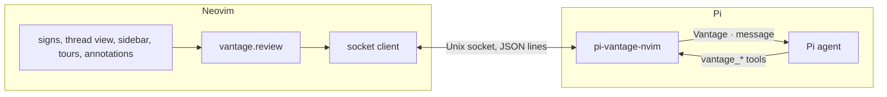

# vantage.nvim

vantage.nvim brings a review loop with your coding agent into Neovim. You ask
about code, queue change requests and send them in rounds, request walkthroughs
and diff tours, and annotate code. The Pi agent running beside you answers in
its own conversation, the same one that edits the code.

Vantage runs no model of its own. It is a Lua plugin plus a Pi extension,
`pi-vantage-nvim`, shipped in this repository. The extension holds the review
state, wakes the agent with a message for each request, and gives it reply
tools; Neovim talks to it over an owner-only Unix socket. There is no Node
process on the Neovim side and no build step.

## How it works



- A **thread** is a question, a change request, a walkthrough request or a diff
  tour request. It attaches to lines of a file, or to the workspace as a whole.
- **Questions**, walkthroughs and diff tours go to the agent as soon as you
  submit them. **Change requests** queue as pending until you send the round;
  the agent then reports each one as done, declined or needs-input.
- The agent answers through its `vantage_answer`, `vantage_request_update`,
  `vantage_walkthrough`, `vantage_diff_tour` and `vantage_annotate` tools. The
  walkthrough and diff-tour tools are always available, so asking Pi itself to
  "walk me through your changes" puts the tour in Neovim too.
- An optional **review base** (a git ref such as `main`) makes every message name
  the diff, and lets you list and open the changed files.
- Threads live in the Pi session's log: they survive Neovim restarts, `/reload`
  and resume, and a new Pi session (`/new`) starts empty. When Pi switches
  sessions, Neovim follows it to the new one.
- When the agent reports a change request done, Vantage reloads unmodified
  buffers from disk so they match what it wrote; buffers with unsaved edits are
  left alone.
- Cancel never aborts the agent's turn. A request the agent has not seen yet,
  including an annotate request, is withdrawn from its message; one it is
  working on gets a stop notice on its next turn.

## Installation

You need Neovim 0.10+, git, and [Pi](https://github.com/earendil-works/pi) with
this repository installed as a Pi package. Diffview is optional; diff tours and
`:VantageReviewFiles` use it.

1. Install the Neovim plugin (no build step):

   ```lua
   -- lazy.nvim
   {
     "napisani/vantage-nvim",
     name = "vantage.nvim",
     branch = "dist",
     opts = {},
   }
   ```

2. Install the extension in Pi from the same checkout, then `/reload` in Pi:

   ```bash
   pi install /path/to/vantage-nvim
   ```

3. Start `pi` in the workspace root you edit in Neovim. Discovery matches the
   canonical git root (or Neovim's cwd outside git) exactly. With one agent
   running there, Vantage connects on the first command; with several, it asks
   which one and sticks to that Pi session.

`:checkhealth vantage` reports whether an agent answers for the current
workspace.

## Public API

Every command is a thin wrapper over a function on `require("vantage")`.
Commands that accept a range work with `:'<,'>` and from visual-mode keymaps
bound to the Lua functions. Commands that take text open the prompt float when
the text is omitted; `@path` and `/skill:name` references are sent as typed and
the agent resolves them.

### Commands

| Command | Range | Reaches the agent | Does |
| --- | --- | --- | --- |
| `:VantageAsk [text]` | Yes | At once | Question thread on the range or cursor line. |
| `:VantageExplain` | Yes | At once | Preset question: explain the lines. |
| `:VantageRequest [text]` | Yes | On `:VantageSendRound` | Queues a pending change request. |
| `:VantageRequestNow [text]` | Yes | At once | A change request sent as its own round. |
| `:VantageSendRound` | No | At once | Sends every pending change request in one message. |
| `:VantageRecallRound` | No | No | Pulls sent requests back to pending before the agent starts them. |
| `:VantageReply [text]` | No | At once (pending: no) | Follows up on the thread at the cursor; edits it while pending. |
| `:VantageCancel [id]` | No | Notice if started | Withdraws or cancels the thread's request; with no thread, cancels the annotate request in flight. |
| `:VantageResolve [id]` | No | No | Toggles resolved; resolved threads hide their signs. |
| `:VantageClearResolved` | No | No | Deletes resolved threads. |
| `:VantageThreadPeek` | No | No | Read-only float for the thread on the cursor line. |
| `:VantageThreadOpen [id]` | No | No | Shows a thread in the bottom split (`vantage://thread/<id>`). |
| `:VantageThreadNext` / `:VantageThreadPrev` | No | No | Moves between threads in the buffer. |
| `:VantageThreadQuickfix [id]` | No | No | Loads the locations in the agent's answer into quickfix. |
| `:VantageThreads` | No | No | Picks a thread with `vim.ui.select`. |
| `:VantageSidebar` | No | No | Toggles the review sidebar. |
| `:VantageWalkthrough [prompt]` | Yes | At once | Requests a walkthrough, starting from the selected lines when given. |
| `:VantageDiffTour [base [target]] -- [prompt]` | No | At once | Requests a diff tour. `--` separates up to two refs from the prompt only as a standalone word. Typed refs win, then the review base, then the agent picks (default HEAD against the working tree). |
| `:VantageTourNext` / `:VantageTourPrev` / `:VantageTourClear` | No | No | Navigates the active walkthrough (quickfix) or diff tour (Diffview), or clears tours. |
| `:VantageReviewBase [ref [target]]` | No | No | Sets the review base; default ref is the default branch, default target the working tree. |
| `:VantageReviewBaseClear` | No | No | Clears the review base. |
| `:VantageReviewFiles` | No | No | Picks a file changed against the base and opens it in Diffview. |
| `:VantageAnnotate [scope] [max]` | Yes | At once | Asks for annotation blocks; scope is `line`, `visible` or `buffer`. |
| `:VantageAnnotationClear` | No | No | Clears annotation blocks and walkthrough notes. |
| `:VantageConnect` | No | No | Finds the agent again, asking which when several run. |
| `:VantageStatus` | No | No | Connection, agent, thread counts, base, tour. |
| `:VantageHealth` | No | No | `:checkhealth vantage`. |
| `:VantageDebugLog` | No | No | Shows socket frames logged to `debug.log_path`. |
| `:VantageCompose` / `:VantageComposeSend` / `:VantageComposeClear` | No | Send: at once | The composition buffer; send asks whether to ask or request. |
| `:VantageSetLens [mode] [text]` / `:VantageClearLens` | No | No | The lens, sent as one line with every request. |
| `:VantageHistory` / `:VantageHistoryClearWorkspace` / `:VantageHistoryClearAll` | No | No | Prompt history. |
| `:VantageMonitor` | No | No | Monitor mode: follow edits made outside this Neovim. |

### Lua API

| Lua function | Command / behavior |
| --- | --- |
| `setup(config)` | Registers commands and views. Warns about removed config keys. |
| `ask(opts)` | `:VantageAsk`. `opts.args` is the text; `opts.workspace = true` drops the anchor. |
| `explain(opts)` | `:VantageExplain`. |
| `request(opts)` / `request_now(opts)` | `:VantageRequest` / `:VantageRequestNow`; `opts.workspace` as for `ask`. |
| `send_round()` / `recall_round()` | `:VantageSendRound` / `:VantageRecallRound`. |
| `reply(opts)` | `:VantageReply`; `opts.thread_id`, `opts.text`. |
| `edit_request(id)` / `delete_request(id)` | Edit or delete a pending change request. |
| `cancel(opts)` / `resolve(opts)` | `:VantageCancel` / `:VantageResolve`; `opts.thread_id`. |
| `clear_resolved()` | `:VantageClearResolved`. |
| `thread_peek()` / `thread_open(id)` | `:VantageThreadPeek` / `:VantageThreadOpen`. |
| `thread_next()` / `thread_prev()` | `:VantageThreadNext` / `:VantageThreadPrev`. |
| `thread_refs_to_quickfix(id)` | `:VantageThreadQuickfix`. |
| `threads(filter)` | Every thread as `{ id, kind, status, resolved, path?, line?, title, text }`, for a picker of your choice. `filter` matches `status`, `kind`, `resolved`, `path`. |
| `pick_thread()` / `sidebar()` | `:VantageThreads` / `:VantageSidebar` (returns whether it is open). |
| `walkthrough(opts)` | `:VantageWalkthrough`. |
| `diff_tour(opts)` | `:VantageDiffTour`; from Lua, `opts.base`, `opts.target`, `opts.prompt`. |
| `tour_next()` / `tour_prev()` / `tour_clear()` | Tour navigation. |
| `set_review_base(opts)` / `clear_review_base()` | `opts = { ref?, target? }`. |
| `review_files()` | `:VantageReviewFiles`. |
| `annotate(opts)` / `clear_annotations()` | `:VantageAnnotate` (`opts.fargs`) / `:VantageAnnotationClear`. |
| `connect()` / `status()` / `health()` / `debug_log()` | `:VantageConnect` / `:VantageStatus` / `:VantageHealth` / `:VantageDebugLog`. |
| `statusline()` | One line such as `vantage ● 2 pending · 1 sent · base main`; empty before the first connection. `●` the agent is working, `○` idle, `✕` disconnected. |
| `compose()` / `compose_send()` / `compose_clear()` | Composition commands. |
| `compose_append(text, opts)` | Stages text without showing the buffer; `opts.separation = "blank"`. |
| `is_composition_buffer(bufnr)` | Whether a buffer is the composition buffer. |
| `set_lens(mode, text)` / `get_lens()` / `clear_lens()` / `prompt_lens(mode)` | The lens. |
| `history(opts)` / `history_pick()` / `history_clear_workspace()` / `history_clear_all()` | Prompt history. |
| `monitor()` / `monitor_entries()` | Monitor mode. |
| `prompt(opts)` | Opens the prompt float; `opts.on_submit(text)` gets the text as typed. `opts.title`, `opts.kind`, `opts.params.workspaceRoot`. |
| `format_reference(spec)` | `{ path, start_line?, end_line? }` to `@path`, `@path line N` or `@path lines N-M`. |
| `context(opts)` | Context params for the range, live visual selection or cursor line; `selectionSource` says which. |
| `visual_range()` | The live visual selection's lines, or nil. |

`require("vantage").CommandNames` holds the command names.

### The review core

`require("vantage.review")` is what the built-in views use, and what your own
views can use instead. It never opens windows.

```lua
local review = require("vantage.review")
review.state()                 -- latest state from the extension, or nil
review.threads(filter)         -- flat entries for pickers
review.thread(id)              -- one thread with its messages
review.connection()            -- { status, root, socket, session_id, waiting }
review.ask({ anchor = nil, text = "why?", lens = nil }, function(err, ack) end)
review.request({ text = "rename it", send_now = false }, cb)
review.follow_up(id, text, lens, cb)   review.send_round(cb)   review.cancel(id, cb)
review.resolve(id, true, cb)   review.set_base(base, cb)      review.clear_base(cb)
review.statuses.group(status)  -- "pending", "needs_you", "with_agent", "answered", "cancelled", "other"
review.statuses.needs_you(status)   review.statuses.with_agent(status)   review.statuses.highlight(status)
review.on_change(function(data) end)   -- User VantageReviewChanged, data.revision
```

`User VantageTourPublished` fires with `data = { tour_id, unrequested }` when the
agent publishes a tour.

### Keys in the thread view and sidebar

| View | Keys (defaults) |
| --- | --- |
| Thread split | `r` reply (edit when pending), `x` resolve, `Q` locations to quickfix, `C` cancel, `gd` go to the code, `q` close |
| Sidebar | `<CR>` open thread and show its code, `r` reply, `e` edit, `dd` delete pending, `x` resolve, `C` cancel, `S` send round, `R` recall round, `q` close |

Configure them under `review.keymaps.thread` and `review.keymaps.sidebar`.

## Configuration

```lua
require("vantage").setup({
  review = {
    sign_text = "▍",
    thread_split_height = 15,
    sidebar_width = 40,
    annotate_timeout_ms = 300000,
    keymaps = { thread = {}, sidebar = {} },
  },
  composition = { clear_on_send = true, close_on_send = true, separator = "---" },
  history = { enabled = true, limit = 50 },
  monitor = { interval_ms = 1000 },
  ui = {
    keybind_hints = true,
    prompt = { keymaps = { submit = "<CR>", cancel = "<Esc>", close = "q" } },
    composition = { keymaps = { send = "<C-g>", close = "q" } },
    input = { provider = "vim.ui.input", lens = { prompt = "Vantage lens: " } },
  },
  debug = { log_path = nil },
})
```

There is no model, provider or auth configuration: the Pi agent uses its own.

### Prompt buffer completion

Vantage installs no completion engine. To complete `/skill` names from the
connected agent's skills:

```lua
require("vantage.integrations.cmp").setup()                   -- nvim-cmp
local ok, provider = require("vantage.integrations.blink").setup() -- blink.cmp
```

Prompt buffers have the `vantage_prompt` filetype; detect them with
`b:vantage_prompt_buffer`. Use your completion plugin's path source for `@file`.

## Composition

The composition buffer is a persistent staging area: you accumulate references,
selections, and instructions into it across many actions, edit it freely as
markdown, then send the whole thing once.

```vim
:VantageCompose         " toggle it open/closed
:VantageComposeSend     " send everything staged
:VantageComposeClear    " throw away what's staged
```

Appending stages silently and notifies with a running entry count. Inside the
buffer, `<C-g>` sends and `q` closes the window; closing only hides it. Sending
asks whether to ask a question, queue a change request or send one now, and the
thread is about the workspace as a whole. The content stays staged until the
extension accepts the thread.

`compose_append` handles separation:

```lua
local vantage = require("vantage")
local ctx = vantage.context()
vantage.compose_append(vantage.format_reference({
  path = ctx.filePath,
  start_line = ctx.range and ctx.range.startLine,
  end_line = ctx.range and ctx.range.endLine,
}), { separation = "blank" })
```

Integrations scoped to the buffer should use `require("vantage").is_composition_buffer()`.

## Prompt History

Every prompt you submit is recorded — from the prompt buffer, from an inline
command argument (`:VantageAsk why is this slow`), or from a composition
send. Cycle them in place with `<Up>` and `<Down>`:

```vim
:VantageHistory                  " pick from this workspace's history
:VantageHistoryClearWorkspace    " purge this workspace
:VantageHistoryClearAll          " purge everything
```

**Arrow keys cycle on every line**, in both the prompt buffer and the
composition buffer. That is a deliberate trade for consistency: those two buffers
lose `<Up>`/`<Down>` cursor movement, so use `j`/`k` to move within a multi-line
prompt. Rebind under `ui.prompt.keymaps` / `ui.composition.keymaps`
(`history_prev`, `history_next`), or set `history.enabled = false` to drop the
keymaps entirely. blink.cmp's own arrow mappings include `fallback`, so its
completion menu still wins while open.

Cycling never loses what you were typing: the buffer's content when you started
cycling is held as a draft and restored when you cycle back past the newest
entry. In the composition buffer, recall replaces the **whole** buffer — the
staged work is recoverable by cycling back, but submitting a recalled entry
discards it, so treat that as the one sharp edge.

### What is recorded

- The **raw text you typed**, never the reference-expanded version — so a
  recalled prompt keeps its `@file` mentions intact and re-expands against
  whatever workspace you are in now.
- Abandoned prompt-buffer text, when you close the float without submitting.
  Those entries cycle normally (that is the point — rescuing a mis-closed
  prompt) and are marked `~` in `:VantageHistory`, so "what did I actually send"
  stays answerable.
- Cycling only offers entries from the current workspace; `history()` returns
  every workspace.

### Where it lives

Each row carries a schema version, so a later field change can migrate old rows rather than silently reading them as absent. The file is created `0600` in a `0700` directory -- prompt text should not be world-readable. Rewrites (compaction and the clear commands) stage through a temp file and rename, so a failed write cannot truncate your history, and a clear filters what is actually on disk rather than this session's capped view.

An append-only NDJSON file, by default
`stdpath("state").."/vantage/prompt-history.ndjson"` — user-global, deliberately
outside any project, since prompt text should not be committable. Append-only so
several Neovim instances interleave instead of overwriting each other; the file
is compacted on load once it grows well past `history.limit`.

Prompt text sits unencrypted at rest there, which is why the clear commands
exist. A corrupt line is skipped rather than fatal, and a failed write never
breaks a submit — history is a convenience, and is built to fail quietly.

## Monitor Mode

A live review feed for edits made to your workspace by something *other* than
this Neovim — in practice, an agent running in an adjacent pane.

```vim
:VantageMonitor        " toggle the mode on and off
```

While active, Vantage polls `git status --porcelain` on a timer and opens each
changed file in the current window, cursor on its first changed hunk. New files,
deletions, and gitignore filtering all come free, because git already computes
them.

**Monitor mode binds no keys.** Opening a file is already a Vim jump, so each
change lands in the jumplist and `<C-o>` / `<C-i>` walk the trail of recent
edits with nothing of Vantage's involved:

```
        agent edits three files
        ────────────────────────────────▶
        a.lua        b.lua        c.lua       ← you end here
          ▲            ▲            │
          └── <C-o> ───┴── <C-o> ───┘
                  <C-i> walks forward again
```

A burst renders every change in order, oldest first, so the trail matches the
order the files actually changed in.

Three behaviors are worth knowing, because each defends against a specific way
this could go wrong:

**Your own writes are ignored.** A `BufWritePost` in this instance suppresses
that path for `monitor.self_write_grace_ms`, so saving a file does not replay it
back at you as though the agent had written it.

**Nothing moves while you are typing.** The renderer acts only in normal mode.
Swapping the buffer out from under someone mid-insert would send their next
keystrokes into the file the agent is editing. The change still enters the ring,
so `monitor_entries()` and anything built on it still sees it.

**A modified buffer is never reloaded.** If a changed file has unsaved work,
Vantage reports that it changed on disk rather than discarding your edits.

### Replacing the presentation

`monitor.render` replaces the built-in behavior wholesale and receives one
context table, which is how a diff view stays yours to configure — Vantage never
names a diff plugin:

```lua
monitor = {
  render = function(context)
    -- context.path      absolute path to the changed file
    -- context.status    two-character git porcelain code
    -- context.workspace workspace root being watched
    -- context.line      first changed line, or nil
    -- context.deleted   true when the path is gone
    vim.cmd("DiffviewOpen -- " .. vim.fn.fnameescape(context.path))
  end,
  on_stop = function()
    vim.cmd("DiffviewClose")
  end,
}
```

A single table rather than positional arguments, so the contract can gain fields
without breaking renderers that already exist. `monitor.source` is the matching
seam on the detection side.


## Development

```bash
mise install
mise exec -- npm install
make check        # typecheck, lint, extension tests, Neovim tests
make test-ext     # node:test specs for pi-vantage-nvim
make test-nvim    # headless Neovim suite
make run          # a Neovim with only this plugin loaded
```

Layout:

- `pi-vantage-nvim/` is the Pi extension: `state.ts` (types and the reducer),
  `store.ts`, `actions.ts` (what Neovim may send), `messages.ts` (what the agent
  reads), `review.ts` (behavior behind a `PiPort`), `tools.ts`, `server.ts` (the
  socket), `index.ts` (Pi wiring). Tests run against a fake `PiPort`.
- `lua/vantage/review/` is the Neovim side: `client.lua` (socket), `core.lua`
  (state and actions, no windows), `anchors.lua`, `git.lua`, and `ui/`.
- `nvim/tests/` is the Lua suite. `support/extension_host.ts` runs the real
  extension on a real socket so specs can play the agent; see `AGENTS.md` for
  the spec layout.

A manual smoke test with a real model: start `pi` in a fixture repo with this
package installed, then ask, send a round of two requests, request a
walkthrough from Neovim, ask Pi for one directly, request a diff tour against
`main`, annotate the visible lines, and cancel a queued request while the agent
is busy.
